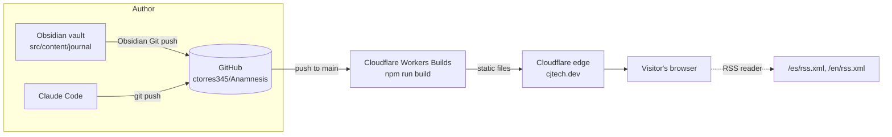
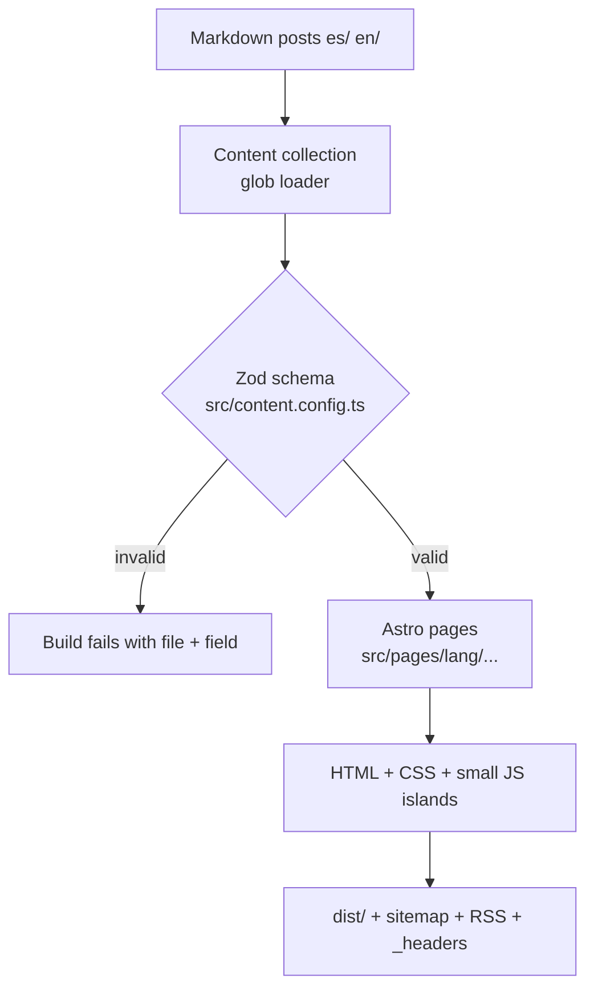

# Architecture and system design

How cjtech.dev is built, how a post gets from a note to the web, and why each choice was made. For colors, fonts and the other design tokens, see [DESIGN-SYSTEM.md](DESIGN-SYSTEM.md). For writing posts, see [WRITING.md](WRITING.md).

## 1. Goals and limits
| Goal | How the design meets it |
|---|---|
| Easy to maintain, one person, few hours a week | Posts are Markdown files; no server, no database, nothing to patch |
| Dynamic, nice UI | Small interactive islands + page transitions on top of static HTML |
| Spanish and English | Two route trees (`/es/`, `/en/`), UI text in one file per language |
| Cost zero | Cloudflare free plan; no paid services |
| Privacy | No cookies, no accounts, no tracking; `localStorage` only for the theme |
| Safe publishing | Every post is type-checked at build time; a bad post stops the deploy |

## 2. System overview

Every page is a file built ahead of time and served from Cloudflare's edge. The only server code is a tiny Worker for `/api/reactions` (section 7).

## 3. Build pipeline

`npm run build` = lint + tests + `astro check` (TypeScript) + `astro build` + Pagefind index. Cloudflare runs exactly this, so a failing test or a broken `[[link]]` stops the publish and the previous version stays live. Social images (`/og/{lang}/{slug}.png`) are drawn with Satori during the build. Drafts (`draft: true`) are skipped in production and shown in `npm run dev`.

## 4. Code structure
| Folder / file | Role |
|---|---|
| `src/content/journal/{es,en}/` | Posts. File name = URL slug |
| `src/content/journal/_templates/` | Obsidian templates, never published |
| `src/content.config.ts` | Post schema: kinds, required blocks per kind |
| `src/pages/index.astro` | `/`: sends visitors to `/es/` or `/en/` by browser language |
| `src/pages/[lang]/` | Home, journal list, entry pages, projects, games, ideas, about, tags, stack, RSS |
| `src/pages/og/` | Social preview images (PNG) per post |
| `worker/` | The `/api/reactions` Worker and its tests |
| `src/content/journal/pages/` | About page in Markdown (inside the Obsidian vault) |
| `src/layouts/BaseLayout.astro` | `<head>` (SEO, social preview, fonts), header, footer, page transitions |
| `src/components/` | Static components (no JavaScript): header, footer, theme toggle, game shelf |
| `src/islands/` | Interactive Preact components: inkblot, mind map, journal filters, Likert |
| `src/lib/` | Plain TypeScript: i18n text, journal queries, inkblot generator, mind map data, profile links |
| `src/styles/` | Design tokens, global styles, island styles |
| `public/` | Files copied as-is: favicon, social image, `_headers` |

## 5. Rendering model: islands
Pages are plain HTML. Only five components ship JavaScript, and each loads only when needed:

| Island | Loads | Why it needs JS |
|---|---|---|
| `Inkblot` | when visible | "New card" button |
| `MindMap` | when visible | hover/tap highlights, measures its box to draw lines |
| `JournalList` | on load, journal page only | filter chips. On the home page it renders as plain HTML |
| `Likert` | when visible | sends the answer, shows the counts |
| `Search` | when the browser is idle | `Ctrl K` dialog over the Pagefind index |

Islands use Preact (~4 KB) with the same hooks API as React. Page-to-page navigation uses Astro's `ClientRouter` (view transitions).

## 6. Internationalization
- Routes: `/es/...` and `/en/...`. `/` redirects by browser language (default Spanish).
- UI text: `src/lib/i18n.ts`. Post text lives only in the posts.
- Two versions of a post are linked by the same `translationKey`. If one is missing, the entry page says "Only in English" / "Solo en español".
- Each page outputs `hreflang` alternates and a canonical URL.

## 7. Hosting, caching and security
- **Cloudflare Workers static assets**, config in `wrangler.jsonc`, custom domain `cjtech.dev`, `404.html` for missing pages.
- **Worker** (`worker/index.ts`) runs only for `/api/*`. `GET /api/reactions?post=en/slug` returns `{ counts: [n1..n5] }`; `POST` with `{ post, answer }` adds one. It accepts same-origin POSTs only, checks the post really exists, and stores five numbers per post in Workers KV (`REACTIONS`). No IP, no cookie, no visitor ID. The browser remembers locally that it already answered.
- **Comments**: giscus loads from giscus.app on entry pages (only when configured).
- **Caching** (`public/_headers`): hashed files in `/_astro/` are cached for a year; HTML is revalidated so new posts show up right away.
- **Security headers**: CSP (only same-origin scripts, plus Cloudflare Web Analytics if enabled), `X-Frame-Options: DENY`, `nosniff`, strict referrer, no camera/mic/location.
- **SEO**: sitemap (`/sitemap-index.xml`), RSS per language, Open Graph image (`public/og.png`), canonical and `hreflang` links.

## 8. Quality checks
| Check | Command | Catches |
|---|---|---|
| Lint | `npm run lint` (oxlint) | code smells |
| Unit tests | `npm test` (Vitest) | logic (inkblot symmetry, blob shapes) and color contrast of every token pair |
| Types + content | `npm run build` (`astro check` + schema) | type errors, invalid posts |

## 9. Planned pieces (not built yet)
| Feature | Design | Cost |
|---|---|---|
| Newsletter | Buttondown embed form + existing RSS | Free tier |
| Lighthouse in CI | Run Lighthouse against a preview deploy | Free |

## 10. Decisions
| Date | Decision | Why |
|---|---|---|
| 2026-11-02 | Astro static site on Cloudflare Workers | Content site, zero cost, same host as Yuyay |
| 2026-11-02 | Markdown + Obsidian, no CMS | Cesar already writes in Obsidian; git keeps history |
| 2026-11-02 | Style "Mind Notebook" | Shows engineering, psychology, games, art and writing |
| 2026-11-02 | Preact instead of React for islands | Same code, ~60 KB less JavaScript |
| 2026-11-02 | Direct pushes to `main` allowed in this repo only | Personal site, single author |
| 2026-11-03 | Lucide icons; blobs generated in code; CSS draw-on animations | Real icons instead of emoji. No Lottie (a player adds ~60 KB+ of JS) and no unDraw (generic flat style that doesn't match the pixel/notebook look) |
| 2026-11-03 | Tests run on every publish; Worker + KV for 1–5 counts; Pagefind search; Satori social images; giscus comments; Obsidian wikilinks | All free tier; still no visitor data |
| 2026-11-03 | Automated WCAG contrast test on design tokens | Caught grey text at 4.0:1 on the lavender band; fixed to 4.8:1 |
